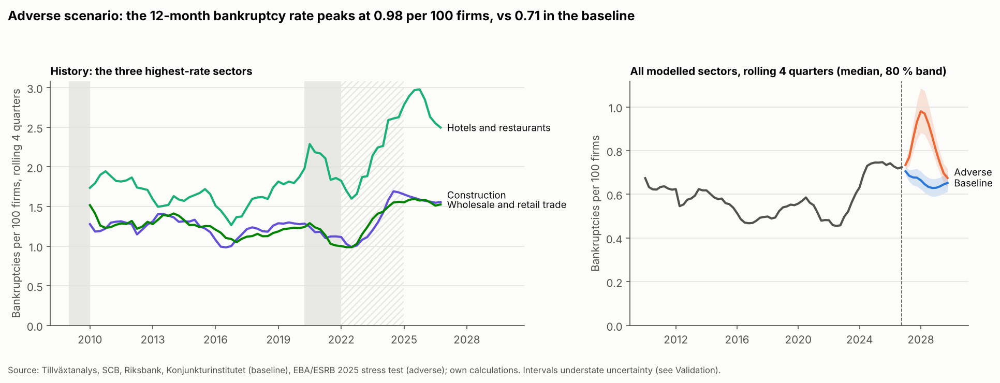
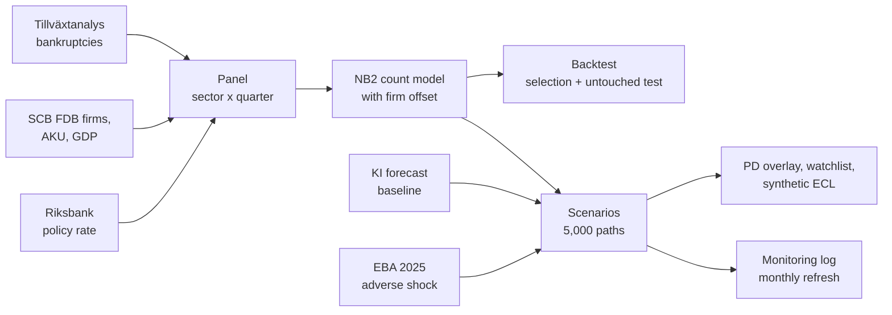

# Swedish SME Bankruptcy Rates under Macro Stress

How much could company bankruptcies in Sweden rise by industry over the next three years if
the economy turns, and which industries should a bank lending to small firms watch? This
project links official Swedish bankruptcy statistics to unemployment, GDP and the policy
rate, and runs a baseline and an EBA-style adverse scenario through that model. Under the
adverse scenario the 12-month bankruptcy rate for the modelled industries peaks at
**0.95 per 100 firms** (2027Q4), against
0.72 today. Full report: [Quarto report](https://davka99.github.io/se-bankruptcy-stress-scenarios/) (published when the repository is public).



## Business question

How much could the corporate bankruptcy rate in Sweden rise by industry over the next 8–12
quarters under a baseline and an adverse macro scenario, and which industries should a bank
with SME lending put on its watchlist, reprice or limit?

## Key findings

- **Adverse scenario:** the 12-month bankruptcy rate across the nine modelled industries
  peaks at 0.95 per 100 firms in 2027Q4 (80 %
  interval 0.85–1.06), up from
  0.72 in the latest four quarters (0.56 in 2019).
  In the baseline (Konjunkturinstitutet's forecast) it eases to 0.60.
- **Construction** rises from 1.56 to 2.07 bankruptcies per 100
  firms per year in 2027Q1–2027Q4 (80 % interval 1.79–2.38);
  **hotels and restaurants** from 2.50 to 3.06
  (2.63–3.55).
- **Unemployment is the driver that matters:** a 1 percentage-point rise in unemployment
  over a year is associated with a +11.6 % change in expected bankruptcies (95 % CI +6.5 to +16.9 %).
  The selected model uses one common slope, so the *percentage* effect is the same in every
  industry; in *percentage points* it is largest in hotels and restaurants
  (+0.29 pp) and construction (+0.18 pp). GDP growth and the
  policy rate add little once unemployment is in the model.
- **Honest validation:** in the untouched test period (2023–2026) the model does **not**
  beat a seasonal-naive forecast one year ahead (MAE 0.171 vs
  0.100 pp of the annual rate), but it does beat the same model without
  macro terms (0.182). Its 80 % intervals covered only 38 % of
  outcomes, so the intervals shown here understate the true uncertainty.

## Recommendation

1. **Watchlist (pre-registered rule):** under the adverse scenario all 9 industries
   meet the criterion (median rate in some 4-quarter window ≥ 1.25 × its historical mean and
   the 10th percentile above the mean). Because the selected model has a common slope, the
   relative rise is similar everywhere, so priority is set by the increase in percentage
   points: **Hotels and restaurants** (+1.15 pp vs its historical mean),
   **Construction** (+0.76 pp) and **Wholesale and retail trade** (+0.75 pp).
2. **PD overlay:** apply a probability-weighted (70 % baseline / 30 % adverse) overlay of
   about +17 % to construction, +19 % to hotels and restaurants and
   +16 % to trade on top of through-the-cycle PDs (first scenario year; the
   adverse-only overlay is +44 to +50 %). The overlay depends only on
   real data; the ECL amounts in this repository come from a **synthetic** portfolio.
3. **Re-assessment trigger:** review pricing and limits for the priority industries when
   SCB's seasonally adjusted unemployment rate is 1 pp or more above its level a year
   earlier, or when the monitoring log turns red for an industry two quarters in a row.

## Approach



- **Rate:** bankruptcies per quarter × 4 / enterprises in SCB's Business Register (FDB) the
  previous November. FDB reproduces all nine published 2023 shares in Tillväxtanalys'
  annual report after rounding (mean absolute deviation 0.030 pp).
- **Model:** negative binomial (NB2) regression of quarterly counts with log(firms) as
  offset, industry fixed effects, quarterly seasonality, a trend, a pandemic-support dummy
  and the change in unemployment, GDP growth and the change in the policy rate. Poisson
  shows strong overdispersion (Pearson χ²/df 5.05 vs 1.11 for NB2).
- **Pre-registration:** the 8-specification grid, the selection metric and the watchlist
  rule were committed before any model was estimated (`docs/decisions.md`, tag `prereg`).
  Selected: `A_k0` (common slopes, same-quarter drivers).
- **Scenarios:** baseline = KI's latest forecast; adverse = baseline + (EBA adverse − EBA
  baseline) for scenario years 1–3, i.e. EBA's shock size moved to today's starting point.
  Unemployment peaks at 14.5 % in the adverse path.

## Data

| Data | Source | Notes |
|---|---|---|
| Company bankruptcies by industry and month, 2009– | [Tillväxtanalys statistics portal](https://statistik.tillvaxtanalys.se/PxWeb/pxweb/sv/Tillv%C3%A4xtanalys%20statistikdatabas/) (PxWeb API) | Official statistics; sole traders included |
| Enterprises by industry (denominator) | [SCB FDB, TAB5166](https://www.statistikdatabasen.scb.se/pxweb/en/ssd/) (PxWebApi v2) | November stock, SNI 2007 |
| Unemployment 15–74, GDP | SCB AKU `TAB6387`, national accounts `TAB4553` (PxWebApi v2) | Seasonally adjusted |
| Policy rate | [Riksbank SWEA API](https://api.riksbank.se/swea/v1/Series) | Daily, averaged per quarter |
| Baseline scenario | [Konjunkturinstitutet forecast database](https://www.konj.se/) | Vintage 20260930, retrieved 2026-11-23 |
| Adverse shock | [EBA 2025 EU-wide stress test](https://www.eba.europa.eu/eu-wide-stress-test-2025) | EBA 2025 EU-wide stress test, macro-financial scenario, corrigendum 2025-02-26 |

Bankruptcy, firm, macro and scenario data are **real** and were retrieved on
2026-11-23; raw snapshots with checksums are committed in `data/raw/`. The SME loan
portfolio used for ECL is **synthetic** (`reports/tables/synthetic_*.csv`). Details:
`docs/data_sources.md`, `docs/data_dictionary.md`.

## How to run

Windows (PowerShell):

```powershell
python -m venv .venv
.venv\Scripts\Activate.ps1
pip install -r requirements.txt
python -m src.pipeline      # rebuild everything from the committed raw data
pytest
```

macOS/Linux:

```bash
python -m venv .venv
source .venv/bin/activate
pip install -r requirements.txt
python -m src.pipeline
pytest
```

`python -m src.pipeline --refresh` fetches new data from the APIs first. The README is
generated: `python -m src.render_readme`.

## Project structure

```
data/raw/          dated raw snapshots + manifest.json (committed)
data/reference/    sector map, validation anchor, parsed EBA scenario
data/processed/    panels (CSV; Parquet when pyarrow is installed)
data/fixtures/     small synthetic data for CI
src/fetch/         one module per source (retry, timeout, manifest)
src/build_panel.py panels and denominators
src/eda.py         exploratory figures
src/models/        NB2 estimator, satellite model, baselines
src/backtest.py    selection and test-period backtest; src/realtime.py real-time variant
src/scenarios.py   KI baseline, EBA deviations, simulation, watchlist, stress grid
src/portfolio_overlay.py  synthetic portfolio, PD overlay, ECL
src/monitoring.py  quarterly traffic-light monitoring
docs/              decisions (pre-registration), sources, dictionary, EDA notes
reports/           figures, tables, decision memo, Quarto report
```

## Validation

| Metric (h = 4 quarters, firm-weighted MAE, pp of annual rate) | Selection period (targets to 2022Q4) | Test period (2023Q1–) |
|---|---|---|
| Satellite model `A_k0` | 0.082 | 0.171 |
| Seasonal naive | 0.073 | 0.100 |
| ETS | 0.075 | 0.108 |
| NB2 without macro | 0.082 | 0.182 |
| Coverage of 80 % intervals (satellite) | 57 % | 38 % |

The backtest is **conditional**: it uses the actual macro outcomes over the forecast
horizon, so it measures the macro-to-bankruptcy link, not the ability to forecast the
economy. A real-time variant with KI's forecast vintages gives a test-period MAE of
0.184. Validation against Tillväxtanalys' published 2023 shares:
mean absolute deviation 0.030 pp (max 0.048). Monitoring log
(2026Q2): 6 green, 1 yellow,
2 red (Education, health and other services, Information and communication).

## Limitations

- **Bankruptcy is not default.** Bank default (90 days past due or unlikely to pay) comes
  earlier and is broader; the overlay is therefore relative, not a PD level.
- **Denominator:** FDB counts all registered enterprises, including dormant ones, so rates
  are low in absolute terms (agriculture especially).
- **Few cycles and a weak test result:** the model loses to seasonal naive in the test
  period and its intervals are too narrow (residuals are autocorrelated). Scenario bands
  include parameter and count uncertainty only, not scenario uncertainty.
- **Common slope:** the selected model gives the same percentage effect in every industry;
  differences between industries come from their levels.
- **y/y drivers:** the effect of unemployment fades once unemployment stops rising, even if
  it stays high, so the adverse path returns towards the baseline in year 3.
- **Pandemic break** handled with a dummy (2020Q2–2021Q4); estimates are sensitive to it
  (`reports/tables/sensitivity_pandemic_denominator.csv`).
- **Unspecified industry** was ~16 % of bankruptcies in 2009–10 and ~7 % later, which
  biases early sector counts down. No SNI 2025 level jump was found in 2026.
- **No scenario probabilities, no lifetime PDs, no staging or SICR**; the ECL is a
  simplified 12-month calculation on synthetic loans.

## Technology

Python 3.12 (pandas, numpy, scipy, statsmodels for cross-checks, matplotlib), SCB PxWebApi
v2, PxWeb API v1 (Tillväxtanalys, KI), Riksbank SWEA, pytest, ruff, GitHub Actions
(CI on Ubuntu and Windows, monthly data refresh, Pages), Quarto.
