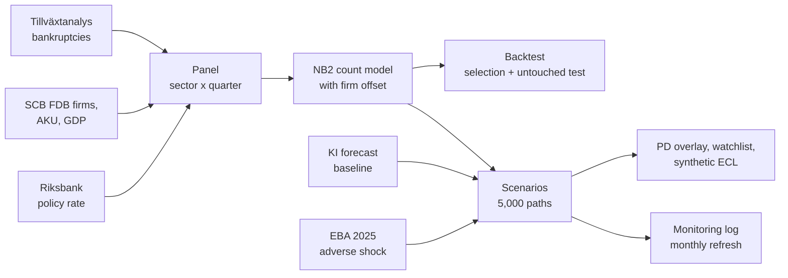

# Swedish SME Bankruptcy Rates under Macro Stress

How much could company bankruptcies in Sweden rise by industry over the next three years if
the economy turns, and which industries should a bank lending to small firms watch? This
project links official Swedish bankruptcy statistics to unemployment, GDP and the policy
rate, and runs a baseline and an EBA-style adverse scenario through that model. Under the
adverse scenario the 12-month bankruptcy rate for the modelled industries peaks at
**{{ total_adverse_peak }} per 100 firms** ({{ total_adverse_peak_q }}), against
{{ total_rate_latest_4q }} today. Full report: [Quarto report](https://davka99.github.io/se-bankruptcy-stress-scenarios/) (published when the repository is public).


## Business question

How much could the corporate bankruptcy rate in Sweden rise by industry over the next 8–12
quarters under a baseline and an adverse macro scenario, and which industries should a bank
with SME lending put on its watchlist, reprice or limit?

## Key findings

- **Adverse scenario:** the 12-month bankruptcy rate across the nine modelled industries
  peaks at {{ total_adverse_peak }} per 100 firms in {{ total_adverse_peak_q }} (80 %
  interval {{ total_adverse_peak_lo }}–{{ total_adverse_peak_hi }}), up from
  {{ total_rate_latest_4q }} in the latest four quarters ({{ total_rate_2019 }} in 2019).
  In the baseline (Konjunkturinstitutet's forecast) it eases to {{ total_baseline_min }}.
- **Construction** rises from {{ CON_rate_now }} to {{ CON_adv_peak }} bankruptcies per 100
  firms per year in {{ CON_adv_peak_window }} (80 % interval {{ CON_adv_peak_lo }}–{{ CON_adv_peak_hi }});
  **hotels and restaurants** from {{ HOR_rate_now }} to {{ HOR_adv_peak }}
  ({{ HOR_adv_peak_lo }}–{{ HOR_adv_peak_hi }}).
- **Unemployment is the driver that matters:** a 1 percentage-point rise in unemployment
  over a year is associated with a {{ irr_d_unemp }} % change in expected bankruptcies (95 % CI {{ irr_d_unemp_ci }} %).
  The model uses one common slope, so the *percentage* effect is the same in every
  industry; in *percentage points* it is largest in hotels and restaurants
  (+{{ effect_pp_HOR }} pp) and construction (+{{ effect_pp_CON }} pp). GDP growth (wrong
  sign, {{ r1_irr_gdp_yoy }} % per percentage point) and the policy rate ({{ r1_irr_d_policy }} %, not
  significant) added nothing in round 1 and were dropped in round 2.
- **Honest validation:** in the untouched test period (2023–2026) the first model did
  **not** beat a seasonal-naive forecast one year ahead (MAE {{ test_mae_sat }} vs
  {{ test_mae_snaive }} pp of the annual rate) and its 80 % intervals covered only
  {{ test_cov_sat }} %. A second, pre-registered round ([below](#round-2-a-better-model-after-the-weak-test))
  dropped GDP and the policy rate and added industry persistence: error
  {{ r2_test_mae_U0_IC085 }} in the same (now already seen) test period, a third lower, but still
  not better than seasonal naive. Its scenarios are used here (`{{ scenario_model }}`); the
  round-1 model gives almost the same headline ({{ r1_total_adverse_peak }} instead of
  {{ r2_total_adverse_peak }} per 100 firms).

## Recommendation

1. **Watchlist:** put {{ r2_watchlist_names }} on the watchlist. They are the
   {{ r2_watchlist_n }} industries whose *additional* bankruptcy rate under stress (adverse minus
   baseline) is at least 1.25 × the average of {{ r2_avg_add_pp }} pp (round-2 rule, A10): hotels and
   restaurants +{{ r2_add_pp_HOR }} pp, construction +{{ r2_add_pp_CON }}, trade +{{ r2_add_pp_TRD }},
   transport +{{ r2_add_pp_TRN }}. The original pre-registered rule (rate ≥ 1.25 × the industry's
   own historical mean) flags {{ watchlist_n }} of 9 and cannot separate them, because with a
   common slope every industry rises by about the same percentage. By *number* of extra
   bankruptcies, {{ r2_top_count_sector }} is largest ({{ r2_top_count_share }} % of the total): many
   firms, low rate, so it matters for volume but not for pricing.
2. **PD overlay:** apply a probability-weighted (70 % baseline / 30 % adverse) overlay of
   about {{ CON_overlay_weighted }} % to construction, {{ HOR_overlay_weighted }} % to hotels and restaurants and
   {{ TRD_overlay_weighted }} % to trade on top of through-the-cycle PDs (first scenario year; the
   adverse-only overlay is +{{ overlay_adv_min }} to +{{ overlay_adv_max }} %). The overlay depends only on
   real data; the ECL amounts in this repository come from a **synthetic** portfolio.
3. **Re-assessment trigger:** review pricing and limits for the priority industries when
   SCB's seasonally adjusted unemployment rate is 1 pp or more above its level a year
   earlier, or when the monitoring log turns red for an industry two quarters in a row.

## Approach



- **Rate:** bankruptcies per quarter × 4 / enterprises in SCB's Business Register (FDB) the
  previous November. FDB reproduces all nine published 2023 shares in Tillväxtanalys'
  annual report after rounding (mean absolute deviation {{ anchor_mad_pp }} pp).
- **Model:** negative binomial (NB2) regression of quarterly counts with log(firms) as
  offset, industry fixed effects, quarterly seasonality, a trend, a pandemic-support dummy
  and the change in unemployment over a year (round 1 also had GDP growth and the change in
  the policy rate). Poisson
  shows strong overdispersion (Pearson χ²/df {{ poisson_dispersion }} vs {{ nb_dispersion }} for NB2).
- **Pre-registration:** the 8-specification grid, the selection metric and the watchlist
  rule were committed before any model was estimated (`docs/decisions.md`, tag `prereg`).
  Selected in round 1: `{{ model_spec }}` (common slopes, same-quarter drivers). Round 2
  (A10) was pre-registered after the weak test result and selected `{{ r2_winner }}`:
  unemployment only, plus an industry intercept correction that carries each industry's
  recent deviation from the model forward and fades by 15 % per quarter.
- **Scenarios:** baseline = KI's latest forecast; adverse = baseline + (EBA adverse − EBA
  baseline) for scenario years 1–3, i.e. EBA's shock size moved to today's starting point.
  Unemployment peaks at {{ adverse_unemp_peak }} % in the adverse path.

## Data

| Data | Source | Notes |
|---|---|---|
| Company bankruptcies by industry and month, 2009– | [Tillväxtanalys statistics portal](https://statistik.tillvaxtanalys.se/PxWeb/pxweb/sv/Tillv%C3%A4xtanalys%20statistikdatabas/) (PxWeb API) | Official statistics; sole traders included |
| Enterprises by industry (denominator) | [SCB FDB, TAB5166](https://www.statistikdatabasen.scb.se/pxweb/en/ssd/) (PxWebApi v2) | November stock, SNI 2007 |
| Unemployment 15–74, GDP | SCB AKU `TAB6387`, national accounts `TAB4553` (PxWebApi v2) | Seasonally adjusted |
| Policy rate | [Riksbank SWEA API](https://api.riksbank.se/swea/v1/Series) | Daily, averaged per quarter |
| Baseline scenario | [Konjunkturinstitutet forecast database](https://www.konj.se/) | Vintage {{ ki_vintage_id }}, retrieved {{ ki_retrieved }} |
| Adverse shock | [EBA 2025 EU-wide stress test](https://www.eba.europa.eu/eu-wide-stress-test-2025) | {{ eba_vintage }} |

Bankruptcy, firm, macro and scenario data are **real** and were retrieved on
{{ ki_retrieved }}; raw snapshots with checksums are committed in `data/raw/`. The SME loan
portfolio used for ECL is **synthetic** (`reports/tables/synthetic_*.csv`). Details:
`docs/data_sources.md`, `docs/data_dictionary.md`.

## How to run

Windows (PowerShell):

```powershell
python -m venv .venv
.venv\Scripts\Activate.ps1
pip install -r requirements.txt
python -m src.pipeline      # rebuild everything from the committed raw data
pytest
```

macOS/Linux:

```bash
python -m venv .venv
source .venv/bin/activate
pip install -r requirements.txt
python -m src.pipeline
pytest
```

`python -m src.pipeline --refresh` fetches new data from the APIs first. The README is
generated: `python -m src.render_readme`.

## Project structure

```
data/raw/          dated raw snapshots + manifest.json (committed)
data/reference/    sector map, validation anchor, parsed EBA scenario
data/processed/    panels (CSV; Parquet when pyarrow is installed)
data/fixtures/     small synthetic data for CI
src/fetch/         one module per source (retry, timeout, manifest)
src/build_panel.py panels and denominators
src/eda.py         exploratory figures
src/models/        NB2 estimator, satellite model, baselines
src/backtest.py    selection and test-period backtest; src/realtime.py real-time variant
src/round2.py      round-2 candidates, conformal bands, additional-rate watchlist (A10)
src/scenarios.py   KI baseline, EBA deviations, simulation, watchlist, stress grid
src/portfolio_overlay.py  synthetic portfolio, PD overlay, ECL
src/monitoring.py  quarterly traffic-light monitoring
docs/              decisions (pre-registration), sources, dictionary, EDA notes
reports/           figures, tables, decision memo, Quarto report
```

## Validation

| Metric (h = 4 quarters, firm-weighted MAE, pp of annual rate) | Selection period (targets to 2022Q4) | Test period (2023Q1–) |
|---|---|---|
| Satellite model `{{ model_spec }}` | {{ sel_mae_sat }} | {{ test_mae_sat }} |
| Seasonal naive | {{ sel_mae_snaive }} | {{ test_mae_snaive }} |
| ETS | {{ sel_mae_ets }} | {{ test_mae_ets }} |
| NB2 without macro | {{ sel_mae_nomacro }} | {{ test_mae_nomacro }} |
| Coverage of 80 % intervals (satellite) | {{ sel_cov_sat }} % | {{ test_cov_sat }} % |

The backtest is **conditional**: it uses the actual macro outcomes over the forecast
horizon, so it measures the macro-to-bankruptcy link, not the ability to forecast the
economy. A real-time variant with KI's forecast vintages gives a test-period MAE of
{{ test_mae_sat_realtime }}. Validation against Tillväxtanalys' published 2023 shares:
mean absolute deviation {{ anchor_mad_pp }} pp (max {{ anchor_max_pp }}). Monitoring log
({{ monitoring_quarter }}): {{ monitoring_green }} green, {{ monitoring_yellow }} yellow,
{{ monitoring_red }} red ({{ monitoring_red_sectors }}).

### Round 2: a better model after the weak test

After the round-1 test result, a second round was pre-registered in `docs/decisions.md`
(A10, committed before any round-2 estimate) with five candidates, selection on the
selection period only, and an adoption rule (at least 5 % better than round 1).


| h = 4, firm-weighted MAE (pp) | Selection period | Test period (already seen) | 80 % coverage, test |
|---|---|---|---|
| Round 1 `A_k0` (three macro drivers) | {{ r2_sel_mae_A_k0 }} | {{ r2_test_mae_A_k0 }} | {{ r2_test_cov_A_k0 }} % |
| `U0` (unemployment only) | {{ r2_sel_mae_U0 }} | {{ r2_test_mae_U0 }} | {{ r2_test_cov_U0 }} % |
| `U0_P4` (+ policy rate, lag 4) | {{ r2_sel_mae_U0_P4 }} | {{ r2_test_mae_U0_P4 }} | {{ r2_test_cov_U0_P4 }} % |
| **`U0+IC085` (selected)** | **{{ r2_sel_mae_U0_IC085 }}** | **{{ r2_test_mae_U0_IC085 }}** | {{ r2_test_cov_U0_IC085 }} % |
| `U0+IC1` (no fading) | {{ r2_sel_mae_U0_IC1 }} | {{ r2_test_mae_U0_IC1 }} | {{ r2_test_cov_U0_IC1 }} % |
| Seasonal naive | {{ r2_sel_mae_snaive }} | {{ r2_test_mae_snaive }} | – |

Coverage is re-simulated in round 2, so it can differ by about one point from the
round-1 table above.

- The selected model is {{ r2_improvement_pct }} % better than round 1 in the selection period,
  so A10's adoption rule switches the scenarios to it. Unemployment effect:
  {{ r2_irr_unemp }} % per percentage point (95 % CI {{ r2_irr_unemp_ci }} %).
- In the test period it cuts the round-1 error by about a third but **still does not beat
  seasonal naive** at four quarters. One quarter ahead it does: {{ r2_test_h1_mae_winner }} vs
  {{ r2_test_h1_mae_snaive }} pp (round 1: {{ r2_test_h1_mae_A_k0 }}), because the correction uses the
  latest quarters. The variant without fading (`U0+IC1`) does better in the test period,
  but it tied in the selection period and lost the pre-registered tie-break; switching to
  it now would be choosing on the test.
- **Intervals:** empirical bands from selection-period errors cover {{ r2_conf_cov_h4 }} % of test
  outcomes at four quarters ({{ r2_model_cov_h4 }} % with the model's own simulated bands) and
  {{ r2_conf_cov_h8 }} % at eight quarters ({{ r2_model_cov_h8 }} %). Better, still below 80 %.
- **What it means:** a one-year-ahead forecast of the bankruptcy rate is hard to beat with
  "same quarter last year" when rates move slowly. The model's job here is to translate a
  macro scenario into rates, which the naive forecast cannot do, and the scenario headline
  barely moves between rounds ({{ r1_total_adverse_peak }} vs {{ r2_total_adverse_peak }} per 100 firms).

## Limitations

- **Bankruptcy is not default.** Bank default (90 days past due or unlikely to pay) comes
  earlier and is broader; the overlay is therefore relative, not a PD level.
- **Denominator:** FDB counts all registered enterprises, including dormant ones, so rates
  are low in absolute terms (agriculture especially).
- **Few cycles and a weak test result:** neither round beats seasonal naive in the test
  period, and round 2 was designed after that period had been seen, so its test numbers
  are not an untouched test. Intervals are too narrow even with empirical bands. Scenario
  bands include parameter and count uncertainty only, not scenario uncertainty.
- **Common slope:** the model gives the same percentage effect in every industry;
  differences between industries come from their levels and from the intercept
  correction. Industry-specific slopes did not improve the backtest (A6).
- **The round-2 watchlist rule** was written after the round-1 percentage-point ranking was
  seen (A10); both rules are reported.
- **y/y drivers:** the effect of unemployment fades once unemployment stops rising, even if
  it stays high, so the adverse path returns towards the baseline in year 3.
- **Pandemic break** handled with a dummy (2020Q2–2021Q4); estimates are sensitive to it
  (`reports/tables/sensitivity_pandemic_denominator.csv`).
- **Unspecified industry** was ~16 % of bankruptcies in 2009–10 and ~7 % later, which
  biases early sector counts down. No SNI 2025 level jump was found in 2026.
- **No scenario probabilities, no lifetime PDs, no staging or SICR**; the ECL is a
  simplified 12-month calculation on synthetic loans.

## Technology

Python 3.12 (pandas, numpy, scipy, statsmodels for cross-checks, matplotlib), SCB PxWebApi
v2, PxWeb API v1 (Tillväxtanalys, KI), Riksbank SWEA, pytest, ruff, GitHub Actions
(CI on Ubuntu and Windows, monthly data refresh, Pages), Quarto.
